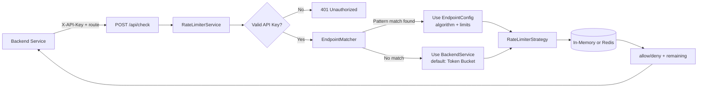
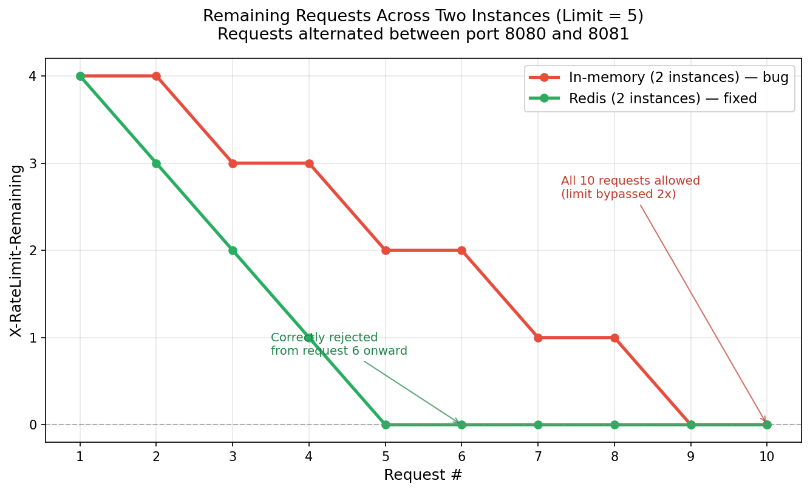

# Rate Limiter as a Service

A rate-limiting API built with Spring Boot that backend services can register with and call before processing a request. Supports three interchangeable rate-limiting algorithms and two interchangeable storage backends (in-memory and Redis), with a demonstrated fix for a real distributed-systems bug along the way.


---

## Table of Contents

- [What This Is](#what-this-is)
- [Architecture](#architecture)
- [Algorithms Implemented](#algorithms-implemented)
- [Storage Backends](#storage-backends)
- [The Multi-Instance Bug (and Fix)](#the-multi-instance-bug-and-fix)
- [API Reference](#api-reference)
- [Data Model](#data-model)
- [Testing](#testing)
- [Design Decisions & Trade-offs](#design-decisions--trade-offs)
- [Tech Stack](#tech-stack)

---

## What This Is

A backend service ("company") registers once and receives an API key. It can then:

1. Call a single `/api/check` endpoint before handling any incoming request, and get back `allow` or `deny` plus how many requests it has left.
2. Optionally register per-endpoint overrides — a different algorithm, limit, or window for specific routes (with wildcard pattern support, e.g. `/orders/*`), falling back to a company-wide default for everything else.

This is a **decision service**, not a reverse proxy: it never touches the caller's actual traffic, it just answers the question "should this go through?"

## Architecture



Key layering:
- **Controller** — parses HTTP, no logic
- **Service** (`RateLimiterService`) — resolves the caller, matches the route to a config, dispatches to the right algorithm
- **Strategy** (`RateLimiterStrategy` interface) — one implementation per algorithm, each with a memory and a Redis variant, selected at startup via a config flag
- **Storage** — `ConcurrentHashMap` (single instance) or Redis + Lua scripts (multi-instance safe)

## Algorithms Implemented

| Algorithm | How it works | Memory cost | Accuracy |
|---|---|---|---|
| **Token Bucket** | Bucket holds tokens up to a capacity, refilled continuously based on elapsed time; each request consumes one token | O(1) per client | Allows controlled bursts |
| **Sliding Window Counter** | Blends a weighted average of the previous and current fixed window's counts, based on how far into the current window the request falls | O(1) per client | Approximate — smooths the "burst at window boundary" problem of naive fixed windows |
| **Sliding Window Log** | Stores every request timestamp in the trailing window, evicts expired ones on each check, counts what's left | O(n) per client (n = requests in window) | Exact — no approximation |

All three implement the same `RateLimiterStrategy` interface and are selected per-endpoint via the `algorithmType` field, so a single deployment can run different algorithms for different routes simultaneously.

Each algorithm is unit tested with a fully deterministic, injectable clock (`TimeSource`) — no `Thread.sleep()`, no flaky timing-dependent tests. Concurrency correctness (exactly N requests succeed under simultaneous load, never more) is verified with a 50-thread test against a shared bucket.

## Storage Backends

The same algorithm can run against two different backends, toggled with one property:

```properties
ratelimiter.storage=memory   # or: redis
```

| Backend | Use case | Atomicity mechanism |
|---|---|---|
| In-memory (`ConcurrentHashMap`) | Single instance only | `ReentrantLock` per bucket key |
| Redis | Multiple instances sharing state | Atomic Lua scripts (entire check-and-update runs as one uninterruptible operation server-side) |

Switching backends requires no code or database changes — it's a deployment-time decision, kept deliberately separate from algorithm choice (which is a per-endpoint business decision, stored in the database).

## The Multi-Instance Bug (and Fix)

This was the most important thing this project set out to prove: **in-memory rate limiting silently breaks the moment you run more than one instance.**

### Setup
Two instances of this service, same registered company, same 5-request limit, requests alternated between port 8080 and 8081 — simulating what a load balancer would do in production.

### Result: in-memory storage

| Request # | Port | Status | Remaining |
|---|---|---|---|
| 1 | 8081 | 200 | 4 |
| 2 | 8080 | 200 | 4 |
| 3 | 8081 | 200 | 3 |
| 4 | 8080 | 200 | 3 |
| 5 | 8081 | 200 | 2 |
| 6 | 8080 | 200 | 2 |
| 7 | 8081 | 200 | 1 |
| 8 | 8080 | 200 | 1 |
| 9 | 8081 | 200 | 0 |
| 10 | 8080 | 200 | 0 |

**All 10 requests were allowed against a configured limit of 5** — each instance kept its own independent counter, so the effective limit doubled with the second instance.

### Result: Redis storage (same test, no code changes, one property flipped)

| Request # | Port | Status | Remaining |
|---|---|---|---|
| 1 | 8081 | 200 | 4 |
| 2 | 8080 | 200 | 3 |
| 3 | 8081 | 200 | 2 |
| 4 | 8080 | 200 | 1 |
| 5 | 8081 | 200 | 0 |
| 6 | 8080 | **429** | 0 |
| 7 | 8081 | **429** | 0 |
| 8 | 8080 | **429** | 0 |
| 9 | 8081 | **429** | 0 |
| 10 | 8080 | **429** | 0 |

**Exactly 5 requests allowed, regardless of which instance handled them** — Redis-backed atomic counters correctly enforce the limit across both processes.



## API Reference

### `POST /api/v1/auth/register`

Registers a new backend service, returns a raw API key (shown once — only its hash is stored).

```json
// Request
{
  "company": "AcmeCorp",
  "origin": "https://acme.com",
  "allowedRequests": 100,
  "defaultWindowSecond": 60
}
```
```
// Response (200)
"rl_8k2n...redacted..."
```

### `POST /api/v1/auth/register-endpoint`

Registers a per-endpoint override. Requires `X-API-Key`.

```json
// Request
{
  "endpointPath": "/orders/*",
  "algorithmType": "SLIDING_WINDOW_COUNTER",
  "allowedRequests": 5,
  "windowSeconds": 10
}
```

### `POST /api/check`

The core check. Requires `X-API-Key`.

```json
// Request
{ "route": "/orders/42" }
```
```
// Response headers (200 or 429)
X-RateLimit-Limit: 5
X-RateLimit-Remaining: 3
```

Full error responses (401 invalid key, 400 validation, 409 duplicate registration, 429 rate limited) are returned as structured JSON via a centralized `@RestControllerAdvice`.

## Data Model

```
BackendService (1) ──< (many) EndpointConfig
```

- `BackendService` — company identity, hashed API key, default algorithm/limits
- `EndpointConfig` — per-route overrides; matched against incoming requests via Ant-style pattern matching (`/orders/*`, `/users/{id}`, etc.), falling back to the company default when nothing matches

Unregistered routes all share **one** default bucket per company — deliberately, to prevent a client from bypassing limits by hitting arbitrarily many distinct, unregistered paths.


## Testing

- Unit tests for all 3 algorithms (in-memory), with deterministic time injection
- Concurrency test: 50 simultaneous requests against a shared bucket, asserting exactly the configured limit succeeds
- End-to-end manual verification via curl scripts for the full registration → override → check flow
- Multi-instance demonstration (above)


## Design Decisions & Trade-offs

- **Decision service, not a proxy.** Chosen to keep the first version scoped and demoable; a reverse-proxy evolution (Model A) is the planned next step.
- **Strategy pattern for algorithms.** Adding a new algorithm or backend means writing one new class and one `@Bean` registration — no changes to the service or controller layer.
- **Algorithm choice vs. storage backend kept as separate axes.** A company picks *what* algorithm it wants (business decision, stored in the DB); the deployment picks *where* state lives (infrastructure decision, a config flag). Conflating these into one enum would mean re-registering every endpoint just to scale the deployment.
- **Sliding Window Log trades memory for exactness**, Sliding Window Counter trades a small accuracy approximation for O(1) memory, Token Bucket allows controlled bursts. All three are legitimate choices depending on the endpoint's traffic pattern — this is why all three exist rather than picking "the best one."
- **SHA-256, not bcrypt, for API key hashing** — bcrypt's deliberate slowness is designed to defend against brute-forcing low-entropy human passwords; API keys are high-entropy random values hashed on every request, where bcrypt's cost becomes a pure performance tax with no corresponding security benefit.


## Tech Stack

Java · Spring Boot · Spring Data JPA · PostgreSQL · Redis (Lettuce) · Lua (Redis scripting) · JUnit 5 · Mockito · Testcontainers · Maven
